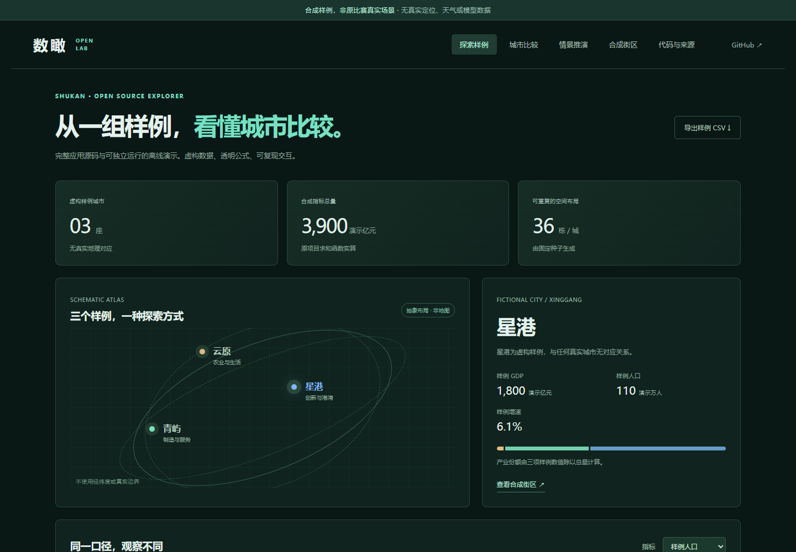
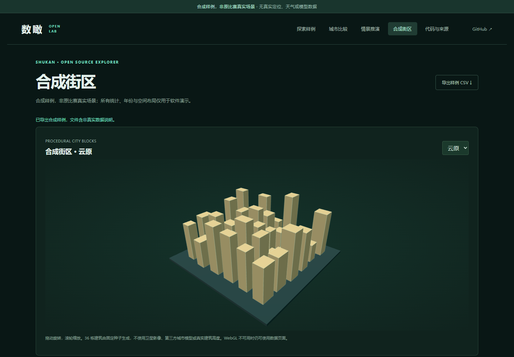

# 数瞰 · 城市探索开源工作台

城市数据探索、比较与情景推演项目的源码归档，以及能独立运行的合成城市演示。

[在线合成演示](https://yangwei251003.github.io/shukan-city-explorer/) · [源码与素材边界](docs/source-scope.md) · [素材许可](ASSET_LICENSES.md)

> **合成样例，非原比赛真实场景。** 原工程中的摄影模型、第三方影像、地图原件和参赛影片未捆绑。演示里的青屿、星港、云原均为虚构城市；指标、历史和建筑布局由代码生成，不代表真实城市、设备定位、官方预测或原比赛效果。





## 项目介绍

原项目“数瞰”尝试把城市统计、地图探索、对比、情景假设、本地规则助手及城市模型查看整合为可追溯的交互产品。本仓库保留其前端、服务端、数据处理和测试源码，方便研究系统如何组织这些功能。

为满足独立公开使用的素材边界，在线入口另行提供轻量演示：

- 三座虚构城市的选择、指标排序、产业占比和人均指标计算。
- 多城比较、可选择城市集合的情景 A/B 推演、基期与目标年份控制。
- 直接复用原项目的求和、指标和逐城复利计算函数，图表随输入实算。
- CSV 导出包含合成数据说明；不输出无来源的真实统计结论。
- Three.js 程序化街区：固定种子生成 36 栋建筑，支持旋转与缩放，无需影像服务或模型下载。
- 手机布局、WebGL 不可用提示、完全离线的演示运行资源。

当前是 **0.4.0 开源整理版**；受控演示已实现，原比赛真实素材的独立再分发权及原体验恢复仍待补齐。本快照不能作为原工程全量备份，也不作为删除原项目的依据。

## 技术栈

React 19、TypeScript 5.8、Vite 6、Three.js 0.186。原源码同时保留 MapLibre、3D Tiles Renderer、Express、dotenv、本地规则/可选模型服务与数据处理管线。具体版本以 `package-lock.json` 为准。

演示入口不启动 Express，不调用天气、模型 API 或在线底图，不读取设备位置。

## 快速上手

准备 Node.js **24** 与 npm。首次安装需要联网下载锁定的软件依赖；无需 API 密钥或账号配置。

```sh
npm ci
npm run dev
```

打开 `http://127.0.0.1:5173/`。

```sh
npm test
npm run licenses:generate
npm run build
npm run preview
```

预览地址通常为 `http://127.0.0.1:4173/`。`npm run build` 对原 `src/` 与新 `demo/` 一并进行类型检查，再生成合成演示的 `dist/`。

复现 GitHub Pages 子目录：

```sh
node scripts/preview-demo.mjs
```

构建后打开 `http://127.0.0.1:4198/shukan-city-explorer/`。Vite 使用相对资源路径，页面采用 hash 路由，可刷新直接打开 `#/scenario` 等页面。

## 验证与在线部署

`npm test` 运行原项目中可脱离真实资料的 5 个数学测试，加上 4 个合成数据、几何、导出与公式检查。原始完整测试保留为 `npm run test:competition`，需要未捆绑的真实数据和模型前置条件；**不声称原 108 项测试已在本快照全部通过**。

本机已有 Google Chrome 时，可运行：

```sh
node scripts/verify-demo.mjs
```

脚本检查桌面和手机五个页面、子目录资源、城市与指标切换、独立公式对照、空选择、CSV 声明及 WebGL2，并更新实际运行截图。需要 Google Chrome；可通过 `BROWSER_CHANNEL` 选择已安装的兼容浏览器。结果见 [本次验证](docs/release-validation.md)。

在 GitHub Settings → Pages 中选择 GitHub Actions，推送 `main` 即由 `.github/workflows/pages.yml` 安装锁定依赖、运行测试、生成许可声明并构建发布 `dist/`。Pages 只发布合成演示。

## 源码导航与原应用恢复

```text
demo/             新合成演示、固定数据生成器与测试
src/              原应用完整前端、指标计算、地图/模型运行时
server/           原应用目录选择、规则解读、天气/可选模型接口
scripts/          原处理/校验脚本，新增演示验证和许可收集工具
tests/            原项目测试源码（部分需要未公开真实资料）
public/fonts/     原 OFL 字体与许可
public/scenes/    原 AI 场景示意 WebP 与来源清单
docs/reference/   原技术与来源历史记录，路径可能指向未公开原件
```

`competition.html` 保留原前端入口，原 App、服务端接口及处理脚本仍在。要恢复原真实数据体验，须先自行取得并配置具有相应使用/发布权的 `public/data/catalog.json`、数据集、地图、模型清单及依赖素材；再运行 `npm run validate:competition-data` 与完整测试，随后用 `npm run dev:competition` 并打开 `/competition.html`。本仓库不自动下载或重新分发这些素材。

原模型制作脚本另需 Python 与各脚本中列出的 GDAL/pyogrio、Shapely、Pillow、NumPy 等第三方环境，以及有效来源文件；它们不属于浏览器演示运行前置。两处原机器路径已改为环境变量 `SHUKAN_OSM_ARCHIVE_DIR`、`SHUKAN_GENERATED_SCENES_DIR`。可选外部模型的私密配置仅由使用者本地提供，禁止提交账号、密钥或私有材料。

## 许可与后续规划

自有及用户有权授权的源码、文档、新生成的合成数据/几何采用 [MIT](LICENSE)。第三方组件、字体、Three.js 派生源码和纹理保留其许可；原项目成员及分工记录保留在原源文件，不将团队成果写成全部由单人完成。来源矩阵与未捆绑素材见 [ASSET_LICENSES.md](ASSET_LICENSES.md)。

后续方向：完善原应用公开资料接入规范、以具有明确开放许可的地理/模型资源恢复更接近原系统的独立体验、继续性能与无障碍测试。更新见 [CHANGELOG](CHANGELOG.md)。
